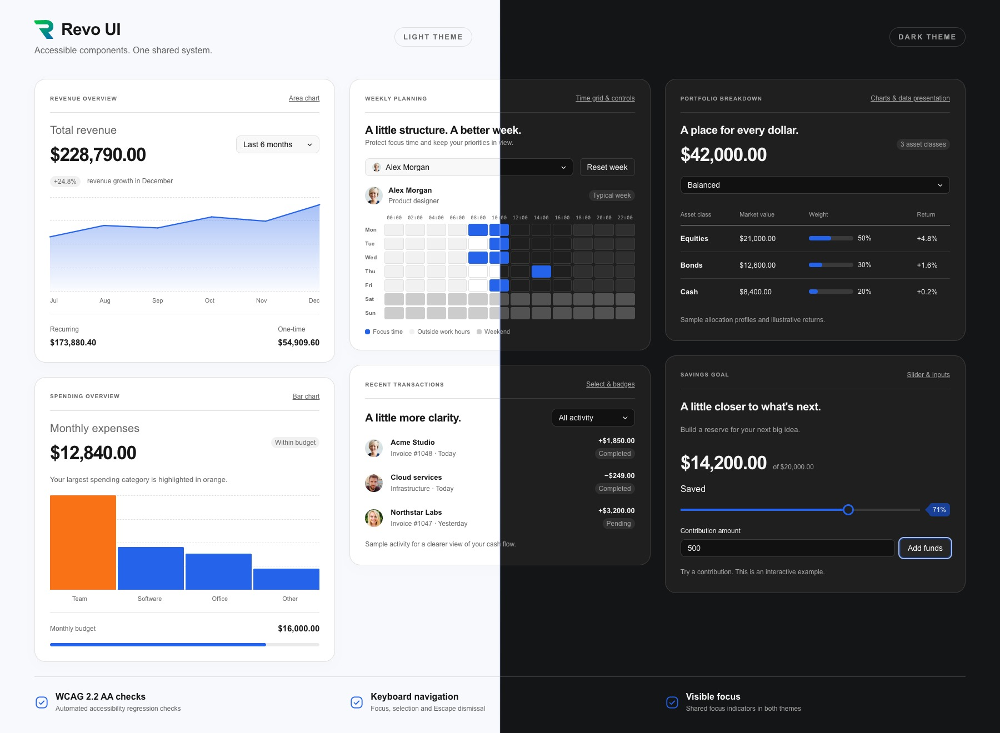

# Revo UI

**RevoGrid's UI component library for financial apps, reporting dashboards, and project management.**

Compose data-rich workspaces with shared controls, pickers, charts, timelines, dialogs, and feedback. Use React, Vue, Angular, Svelte, Preact, or vanilla TypeScript. The package name remains **`@revolist/ui`**.

[Live components](https://ui.rv-grid.com/components/buttons/) · [Interactive overview](https://ui.rv-grid.com/) · [Framework guides](https://ui.rv-grid.com/frameworks/) · [RevoGrid](https://rv-grid.com/) · [Pro documentation](https://pro.rv-grid.com/)

[](https://ui.rv-grid.com/)

## Get started

```sh
pnpm add @revolist/ui preact
```

Import the shared styles once:

```ts
import '@revolist/ui/styles.css';
```

Choose your framework for setup instructions and usage examples:

[React](https://ui.rv-grid.com/frameworks/react/) · [Vue](https://ui.rv-grid.com/frameworks/vue/) · [Angular](https://ui.rv-grid.com/frameworks/angular/) · [Svelte](https://ui.rv-grid.com/frameworks/svelte/) · [Preact](https://ui.rv-grid.com/frameworks/preact/) · [Vanilla TypeScript](https://ui.rv-grid.com/frameworks/vanilla-typescript/)

## Components

Explore live previews, variants, and expandable code examples on the website.

- [Buttons](https://ui.rv-grid.com/components/buttons/) — Actions, icon buttons, toggles, and button groups.
- [Inputs and forms](https://ui.rv-grid.com/components/inputs-and-forms/) — Text, search, numbers, validation, and field layouts.
- [Selects and pickers](https://ui.rv-grid.com/components/selects-chips-and-resources/) — Searchable dropdowns, multiple selections, user images, and assignees.
- [Selection controls](https://ui.rv-grid.com/components/selection-controls/) — Checkboxes, switches, radio buttons, and choice chips.
- [Tabs and lists](https://ui.rv-grid.com/components/tabs-and-lists/) — Tabs, segmented controls, and selectable lists.
- [Sliders](https://ui.rv-grid.com/components/sliders/) — Single values and ranges with labels and value badges.
- [Timeline](https://ui.rv-grid.com/components/timeline-track/) — Draggable, resizable events with colors and tooltips.
- [Calendars and dates](https://ui.rv-grid.com/components/calendar-and-dates/) — Date and time pickers, ranges, and weekly planning.
- [Charts](https://ui.rv-grid.com/components/charts-and-range-selection/) — Bar, line, and area charts with tooltips and range selection.
- [Dialogs and tooltips](https://ui.rv-grid.com/components/dialogs-and-floating-surfaces/) — Dialogs, confirmations, popovers, and tooltips.
- [Menus and toolbars](https://ui.rv-grid.com/components/menus-and-toolbars/) — Dropdown menus, nested commands, and toolbar actions.
- [Status and feedback](https://ui.rv-grid.com/components/status-and-feedback/) — Badges, alerts, loading indicators, and empty states.
- [Layout](https://ui.rv-grid.com/components/layout/) — Panels, resizable split views, and expandable sections.
- [Pagination](https://ui.rv-grid.com/components/pagination/) — Page navigation for tables and lists.
- [Progress and rating](https://ui.rv-grid.com/components/progress-and-rating/) — Progress bars, circular indicators, and star ratings.
- [Activity messages](https://ui.rv-grid.com/components/activity-messages/) — Updates with avatars, timestamps, and actions.
- [AI assistant](https://ui.rv-grid.com/components/ai-assistant/) — Chat messages, prompts, suggestions, and task states.
- [PDF viewer](https://ui.rv-grid.com/components/pdf-viewer/) — PDF navigation, search, zoom, and download controls.
- [Color](https://ui.rv-grid.com/components/color/) — Choose a color from a palette or picker and apply shared semantic interface colors.
- [Field configurators](https://ui.rv-grid.com/components/field-configurators/) — Compose field libraries, selected-field lists, ordering, summaries, actions and drop feedback from shared pieces.
- [Formatting controls](https://ui.rv-grid.com/components/formatting-controls/) — Typography choices, icon choices, inspector sections, preview comparisons and contextual filter badges.

## Complete component reference

For individual component props and API details, see the [complete component reference](docs/component-reference.md#complete-component-reference).

## RevoGrid products

Build alongside [RevoGrid](https://rv-grid.com/), [Grid Pro](https://pro.rv-grid.com/), [Charts](https://rv-grid.com/charts/), [Pivot](https://rv-grid.com/pivot/), [Gantt](https://rv-grid.com/gantt/), [Scheduler](https://rv-grid.com/jsscheduler/), and [Kanban](https://rv-grid.com/kanban/).

## Licensing

Revo UI is [MIT licensed](LICENSE). Anyone can use, modify, and distribute it, including in commercial projects.
