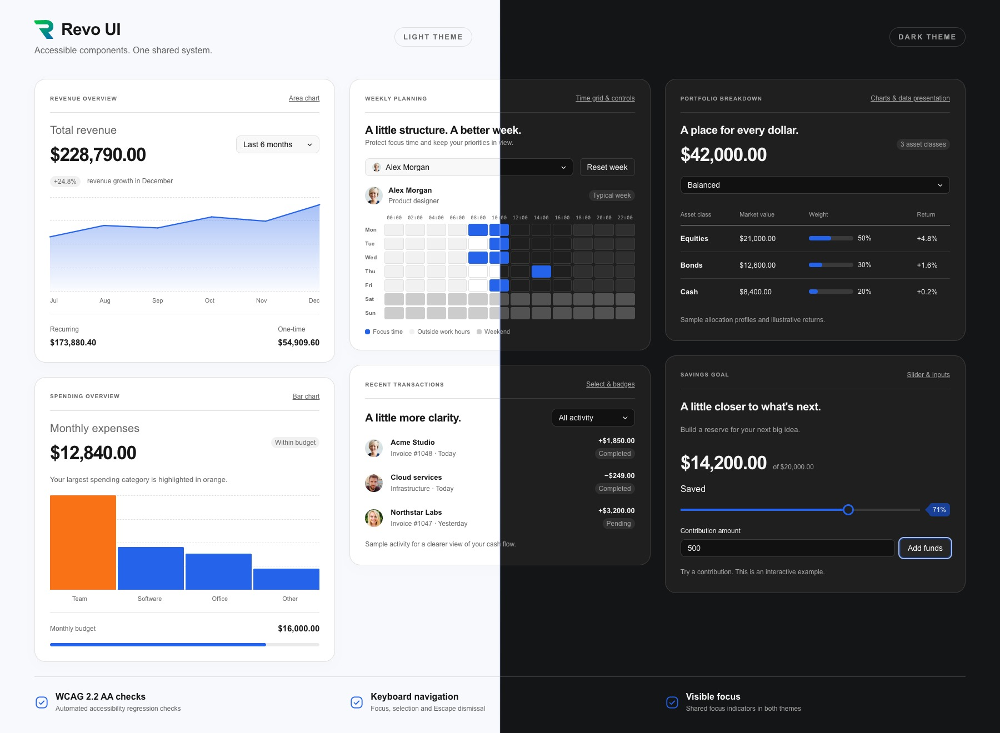

# Revo UI

**RevoGrid's UI component library for financial apps, reporting dashboards, and project management.**

Compose data-rich workspaces with shared controls, pickers, charts, timelines, dialogs, and feedback. Use React, Vue, Angular, Svelte, Preact, or vanilla TypeScript. The package name remains **`@revolist/ui`**.

[Live components](https://ui.rv-grid.com/components/buttons/) · [Interactive overview](https://ui.rv-grid.com/) · [Framework guides](https://ui.rv-grid.com/frameworks/) · [RevoGrid](https://rv-grid.com/) · [Pro documentation](https://pro.rv-grid.com/)

[](https://ui.rv-grid.com/)

## Contents

- [Getting started](#getting-started)
- [Framework integrations](#framework-integrations)
- [Complete component reference](#complete-component-reference)
- [Usage contracts](#usage-contracts)
- [Buttons and navigation](#buttons-and-navigation)
- [Dropdowns with user images](#dropdowns-with-user-images)
- [Advanced slider](#advanced-slider)
- [Conditional chart colors](#conditional-chart-colors)
- [Interactive timeline](#interactive-timeline)
- [Theming, sizing, and motion](#theming-sizing-and-motion)
- [Accessibility and localization](#accessibility-and-localization)
- [RevoGrid products](#revogrid-products)
- [Licensing](#licensing)

## Getting started

Install from a registry configured with access to `@revolist/ui`, or use the package in the RevoGrid workspace. Preact is the shared rendering peer; also install your application's host framework. React adapters require `react-dom`.

```sh
pnpm add @revolist/ui preact
```

Import the shared stylesheet once in your application entry point:

```ts
import '@revolist/ui/styles.css';
```

A controlled React example:

```tsx
import { useState } from 'react';
import { Button, TextInput } from '@revolist/ui/react';

export function ReportName() {
  const [name, setName] = useState('Monthly revenue');
  return (
    <>
      <TextInput aria-label="Report name" value={name} onValueChange={setName} />
      <Button rounded variant="primary" onClick={() => console.log(name)}>
        Create report
      </Button>
    </>
  );
}
```

Controls can be used without a RevoGrid instance. Grid cell templates, providers, row data, and product-specific scheduling logic stay in their owning product packages.

## Framework integrations

| Framework | Entry point | Integration | Guide |
| --- | --- | --- | --- |
| React | `@revolist/ui/react` | Named React components; controlled props, callbacks, children, and custom content. | [React usage](https://ui.rv-grid.com/frameworks/react/) |
| Vue | `@revolist/ui/vue` | Named Vue components, events and slots; declared value models support `v-model`. | [Vue usage](https://ui.rv-grid.com/frameworks/vue/) |
| Angular | `@revolist/ui/angular` | Standalone `UiComponent` host with `component`, `props`, `uiEvent`, `valueChange`, and `rvUiSlot` templates. | [Angular usage](https://ui.rv-grid.com/frameworks/angular/) |
| Svelte 5 | `@revolist/ui/svelte` | `UiComponent` host with reactive props, callbacks, and content snippets. | [Svelte usage](https://ui.rv-grid.com/frameworks/svelte/) |
| Preact | `@revolist/ui/preact` | Direct components with Preact state, hooks, and render callbacks. | [Preact usage](https://ui.rv-grid.com/frameworks/preact/) |
| Vanilla TypeScript | `@revolist/ui/framework` | `createFrameworkMount` and `uiComponents`; call `render` to update and `destroy` on disposal. | [Vanilla usage](https://ui.rv-grid.com/frameworks/vanilla-typescript/) |

Additional entries include `@revolist/ui/native` for DOM controllers and presentation helpers, `@revolist/ui/react-control` / `vue-control` / `angular-control` / `svelte-control` for framework-owned controls, and dedicated entries such as `@revolist/ui/select`, `@revolist/ui/timeline-track`, and `@revolist/ui/pdf-viewer`. Use the installed package's TypeScript declarations for exact prop types.

## Complete component reference

Every component in the shared adapter catalog is listed below. Each name links to a generated prop/API reference, followed by its live example page, where variants and expandable, formatted usage examples are grouped together. Composition helpers are documented alongside their parent control; not every helper has an isolated specimen.

### Buttons

Actions, grouped commands, toggled state, icons, compact sizing, busy states and pill corners.

[Button](api/Button.md) ([examples](https://ui.rv-grid.com/components/buttons/)) | [IconButton](api/IconButton.md) ([examples](https://ui.rv-grid.com/components/buttons/)) | [SvgButton](api/SvgButton.md) ([examples](https://ui.rv-grid.com/components/buttons/)) | [ToggleButton](api/ToggleButton.md) ([examples](https://ui.rv-grid.com/components/buttons/)) | [ButtonGroup](api/ButtonGroup.md) ([examples](https://ui.rv-grid.com/components/buttons/)) | [DeleteButton](api/DeleteButton.md) ([examples](https://ui.rv-grid.com/components/buttons/)) | [RemoveButton](api/RemoveButton.md) ([examples](https://ui.rv-grid.com/components/buttons/)) | [SvgIcon](api/SvgIcon.md) ([examples](https://ui.rv-grid.com/components/buttons/))

### Selection controls

Checkboxes, switches, radio groups, choice chips and option rows for independent or exclusive choices.

[Checkbox](api/Checkbox.md) ([examples](https://ui.rv-grid.com/components/selection-controls/)) | [Switch](api/Switch.md) ([examples](https://ui.rv-grid.com/components/selection-controls/)) | [RadioGroup](api/RadioGroup.md) ([examples](https://ui.rv-grid.com/components/selection-controls/)) | [ChoiceChips](api/ChoiceChips.md) ([examples](https://ui.rv-grid.com/components/selection-controls/)) | [ChoiceChip](api/ChoiceChip.md) ([examples](https://ui.rv-grid.com/components/selection-controls/)) | [ChoiceChipInfoButton](api/ChoiceChipInfoButton.md) ([examples](https://ui.rv-grid.com/components/selection-controls/)) | [OptionButton](api/OptionButton.md) ([examples](https://ui.rv-grid.com/components/selection-controls/))

### Tabs and lists

Switch content, group options and present plain, icon or descriptive selection rows.

[SegmentedControl](api/SegmentedControl.md) ([examples](https://ui.rv-grid.com/components/tabs-and-lists/)) | [SegmentedSwitch](api/SegmentedSwitch.md) ([examples](https://ui.rv-grid.com/components/tabs-and-lists/)) | [Tabs](api/Tabs.md) ([examples](https://ui.rv-grid.com/components/tabs-and-lists/)) | [TabPanel](api/TabPanel.md) ([examples](https://ui.rv-grid.com/components/tabs-and-lists/)) | [Listbox](api/Listbox.md) ([examples](https://ui.rv-grid.com/components/tabs-and-lists/)) | [ListboxOption](api/ListboxOption.md) ([examples](https://ui.rv-grid.com/components/tabs-and-lists/)) | [ListboxGroup](api/ListboxGroup.md) ([examples](https://ui.rv-grid.com/components/tabs-and-lists/)) | [ListboxOptionContent](api/ListboxOptionContent.md) ([examples](https://ui.rv-grid.com/components/tabs-and-lists/)) | [EditorList](api/EditorList.md) ([examples](https://ui.rv-grid.com/components/tabs-and-lists/)) | [EditorListItem](api/EditorListItem.md) ([examples](https://ui.rv-grid.com/components/tabs-and-lists/)) | [EditorListItemContent](api/EditorListItemContent.md) ([examples](https://ui.rv-grid.com/components/tabs-and-lists/)) | [EditorListGroup](api/EditorListGroup.md) ([examples](https://ui.rv-grid.com/components/tabs-and-lists/))

### Inputs and forms

Text, search and numeric entry; field labels, validation, inline layouts and editor drafts.

[Input](api/Input.md) ([examples](https://ui.rv-grid.com/components/inputs-and-forms/)) | [TextInput](api/TextInput.md) ([examples](https://ui.rv-grid.com/components/inputs-and-forms/)) | [Textarea](api/Textarea.md) ([examples](https://ui.rv-grid.com/components/inputs-and-forms/)) | [SearchInput](api/SearchInput.md) ([examples](https://ui.rv-grid.com/components/inputs-and-forms/)) | [NumberInput](api/NumberInput.md) ([examples](https://ui.rv-grid.com/components/inputs-and-forms/)) | [NumberStepper](api/NumberStepper.md) ([examples](https://ui.rv-grid.com/components/inputs-and-forms/)) | [DateInput](api/DateInput.md) ([examples](https://ui.rv-grid.com/components/inputs-and-forms/)) | [TimeInput](api/TimeInput.md) ([examples](https://ui.rv-grid.com/components/inputs-and-forms/)) | [DateTimeInput](api/DateTimeInput.md) ([examples](https://ui.rv-grid.com/components/inputs-and-forms/)) | [FormField](api/FormField.md) ([examples](https://ui.rv-grid.com/components/inputs-and-forms/)) | [FieldHint](api/FieldHint.md) ([examples](https://ui.rv-grid.com/components/inputs-and-forms/)) | [FieldError](api/FieldError.md) ([examples](https://ui.rv-grid.com/components/inputs-and-forms/)) | [FormSection](api/FormSection.md) ([examples](https://ui.rv-grid.com/components/inputs-and-forms/)) | [HighlightedTextInput](api/HighlightedTextInput.md) ([examples](https://ui.rv-grid.com/components/inputs-and-forms/)) | [InlineFieldGroup](api/InlineFieldGroup.md) ([examples](https://ui.rv-grid.com/components/inputs-and-forms/)) | [NumberDraft](api/NumberDraft.md) ([examples](https://ui.rv-grid.com/components/inputs-and-forms/)) | [MaskedDraft](api/MaskedDraft.md) ([examples](https://ui.rv-grid.com/components/inputs-and-forms/)) | [HtmlEditor](api/HtmlEditor.md) ([examples](https://ui.rv-grid.com/components/inputs-and-forms/))

### Selects, chips and resources

Single or multiple selections, searchable options, selected-value templates, avatars, resource lists and assignee fields.

[Dropdown](api/Dropdown.md) ([examples](https://ui.rv-grid.com/components/selects-chips-and-resources/)) | [DropdownPopup](api/DropdownPopup.md) ([examples](https://ui.rv-grid.com/components/selects-chips-and-resources/)) | [DropdownPopupContent](api/DropdownPopupContent.md) ([examples](https://ui.rv-grid.com/components/selects-chips-and-resources/)) | [Combobox](api/Combobox.md) ([examples](https://ui.rv-grid.com/components/selects-chips-and-resources/)) | [MultiSelect](api/MultiSelect.md) ([examples](https://ui.rv-grid.com/components/selects-chips-and-resources/)) | [Chip](api/Chip.md) ([examples](https://ui.rv-grid.com/components/selects-chips-and-resources/)) | [FilterChip](api/FilterChip.md) ([examples](https://ui.rv-grid.com/components/selects-chips-and-resources/)) | [Avatar](api/Avatar.md) ([examples](https://ui.rv-grid.com/components/selects-chips-and-resources/)) | [SharedResourcePicker](api/SharedResourcePicker.md) ([examples](https://ui.rv-grid.com/components/selects-chips-and-resources/)) | [ResourcePickerAvatar](api/ResourcePickerAvatar.md) ([examples](https://ui.rv-grid.com/components/selects-chips-and-resources/)) | [AssigneePicker](api/AssigneePicker.md) ([examples](https://ui.rv-grid.com/components/selects-chips-and-resources/)) | [AssigneeField](api/AssigneeField.md) ([examples](https://ui.rv-grid.com/components/selects-chips-and-resources/)) | [AssigneePickerLayout](api/AssigneePickerLayout.md) ([examples](https://ui.rv-grid.com/components/selects-chips-and-resources/))

### Sliders

Scalar and interval controls with labels, value badges, thumb values, ticks and units.

[SingleValueSlider](api/SingleValueSlider.md) ([examples](https://ui.rv-grid.com/components/sliders/)) | [PreactRangeSlider](api/PreactRangeSlider.md) ([examples](https://ui.rv-grid.com/components/sliders/)) | [SliderField](api/SliderField.md) ([examples](https://ui.rv-grid.com/components/sliders/))

### Timeline track

Controlled timeline events with move/resize interactions, event colors, weighted phases and tooltips.

[TimelineTrack](api/TimelineTrack.md) ([examples](https://ui.rv-grid.com/components/timeline-track/))

### Calendar and dates

Calendar views and date/time fields, ranges, duration drafts, descriptive legends.

[Calendar](api/Calendar.md) ([examples](https://ui.rv-grid.com/components/calendar-and-dates/)) | [CalendarHeader](api/CalendarHeader.md) ([examples](https://ui.rv-grid.com/components/calendar-and-dates/)) | [CalendarWeekdays](api/CalendarWeekdays.md) ([examples](https://ui.rv-grid.com/components/calendar-and-dates/)) | [CalendarDay](api/CalendarDay.md) ([examples](https://ui.rv-grid.com/components/calendar-and-dates/)) | [CalendarMonthGrid](api/CalendarMonthGrid.md) ([examples](https://ui.rv-grid.com/components/calendar-and-dates/)) | [CalendarYearGrid](api/CalendarYearGrid.md) ([examples](https://ui.rv-grid.com/components/calendar-and-dates/)) | [CalendarPicker](api/CalendarPicker.md) ([examples](https://ui.rv-grid.com/components/calendar-and-dates/)) | [DatePicker](api/DatePicker.md) ([examples](https://ui.rv-grid.com/components/calendar-and-dates/)) | [DateRangePicker](api/DateRangePicker.md) ([examples](https://ui.rv-grid.com/components/calendar-and-dates/)) | [DurationField](api/DurationField.md) ([examples](https://ui.rv-grid.com/components/calendar-and-dates/)) | [DurationDraft](api/DurationDraft.md) ([examples](https://ui.rv-grid.com/components/calendar-and-dates/)) | [TemporalPicker](api/TemporalPicker.md) ([examples](https://ui.rv-grid.com/components/calendar-and-dates/)) | [TemporalDraft](api/TemporalDraft.md) ([examples](https://ui.rv-grid.com/components/calendar-and-dates/)) | [DateTimeField](api/DateTimeField.md) ([examples](https://ui.rv-grid.com/components/calendar-and-dates/)) | [Legend](api/Legend.md) ([examples](https://ui.rv-grid.com/components/calendar-and-dates/))

### Weekly time grid

Paint weekly availability with working hours, weekends and keyboard navigation.

[TimeGrid](api/TimeGrid.md) ([examples](https://ui.rv-grid.com/components/weekly-time-grid/))

### Color

Choose a color from a palette or picker and apply shared semantic interface colors.

[ColorPicker](api/ColorPicker.md) ([examples](https://ui.rv-grid.com/components/color/)) | [ColorPalette](api/ColorPalette.md) ([examples](https://ui.rv-grid.com/components/color/))

### Field configurators

Compose field libraries, selected-field lists, ordering, summaries, actions and drop feedback from shared pieces.

[FieldIcon](api/FieldIcon.md) ([examples](https://ui.rv-grid.com/components/field-configurators/)) | [FieldSummary](api/FieldSummary.md) ([examples](https://ui.rv-grid.com/components/field-configurators/)) | [FieldLibrary](api/FieldLibrary.md) ([examples](https://ui.rv-grid.com/components/field-configurators/)) | [FieldGroupHeading](api/FieldGroupHeading.md) ([examples](https://ui.rv-grid.com/components/field-configurators/)) | [FieldGroup](api/FieldGroup.md) ([examples](https://ui.rv-grid.com/components/field-configurators/)) | [FieldList](api/FieldList.md) ([examples](https://ui.rv-grid.com/components/field-configurators/)) | [FieldRow](api/FieldRow.md) ([examples](https://ui.rv-grid.com/components/field-configurators/)) | [FieldContent](api/FieldContent.md) ([examples](https://ui.rv-grid.com/components/field-configurators/)) | [FieldItem](api/FieldItem.md) ([examples](https://ui.rv-grid.com/components/field-configurators/)) | [FieldLibraryList](api/FieldLibraryList.md) ([examples](https://ui.rv-grid.com/components/field-configurators/)) | [SelectedField](api/SelectedField.md) ([examples](https://ui.rv-grid.com/components/field-configurators/)) | [FieldActions](api/FieldActions.md) ([examples](https://ui.rv-grid.com/components/field-configurators/)) | [FieldStatusBadge](api/FieldStatusBadge.md) ([examples](https://ui.rv-grid.com/components/field-configurators/)) | [FieldRemoveButton](api/FieldRemoveButton.md) ([examples](https://ui.rv-grid.com/components/field-configurators/)) | [FieldRemoveIcon](api/FieldRemoveIcon.md) ([examples](https://ui.rv-grid.com/components/field-configurators/)) | [FieldDropIndicator](api/FieldDropIndicator.md) ([examples](https://ui.rv-grid.com/components/field-configurators/)) | [ReorderList](api/ReorderList.md) ([examples](https://ui.rv-grid.com/components/field-configurators/)) | [ReorderHandle](api/ReorderHandle.md) ([examples](https://ui.rv-grid.com/components/field-configurators/))

### Formatting controls

Typography choices, icon choices, inspector sections, preview comparisons and contextual filter badges.

[InspectorSection](api/InspectorSection.md) ([examples](https://ui.rv-grid.com/components/formatting-controls/)) | [IconChoiceGroup](api/IconChoiceGroup.md) ([examples](https://ui.rv-grid.com/components/formatting-controls/)) | [IconToggleButton](api/IconToggleButton.md) ([examples](https://ui.rv-grid.com/components/formatting-controls/)) | [TypographyControls](api/TypographyControls.md) ([examples](https://ui.rv-grid.com/components/formatting-controls/)) | [ComparisonPreview](api/ComparisonPreview.md) ([examples](https://ui.rv-grid.com/components/formatting-controls/)) | [FilterBadgeInfoButton](api/FilterBadgeInfoButton.md) ([examples](https://ui.rv-grid.com/components/formatting-controls/)) | [FilterBadge](api/FilterBadge.md) ([examples](https://ui.rv-grid.com/components/formatting-controls/))

### Charts and range selection

Compact bar, line and area charts with values, labels, tooltips and a composed range brush.

[DistributionChart](api/DistributionChart.md) ([examples](https://ui.rv-grid.com/components/charts-and-range-selection/)) | [BarChart](api/BarChart.md) ([examples](https://ui.rv-grid.com/components/charts-and-range-selection/)) | [LineChart](api/LineChart.md) ([examples](https://ui.rv-grid.com/components/charts-and-range-selection/)) | [AreaChart](api/AreaChart.md) ([examples](https://ui.rv-grid.com/components/charts-and-range-selection/)) | [BrushRange](api/BrushRange.md) ([examples](https://ui.rv-grid.com/components/charts-and-range-selection/))

### Dialogs and floating surfaces

Dialogs, confirmations, contextual surfaces and editable dialog sections with shared actions.

[Dialog](api/Dialog.md) ([examples](https://ui.rv-grid.com/components/dialogs-and-floating-surfaces/)) | [ConfirmDialog](api/ConfirmDialog.md) ([examples](https://ui.rv-grid.com/components/dialogs-and-floating-surfaces/)) | [Popover](api/Popover.md) ([examples](https://ui.rv-grid.com/components/dialogs-and-floating-surfaces/)) | [DialogHeader](api/DialogHeader.md) ([examples](https://ui.rv-grid.com/components/dialogs-and-floating-surfaces/)) | [DialogBody](api/DialogBody.md) ([examples](https://ui.rv-grid.com/components/dialogs-and-floating-surfaces/)) | [DialogFooter](api/DialogFooter.md) ([examples](https://ui.rv-grid.com/components/dialogs-and-floating-surfaces/)) | [DialogForm](api/DialogForm.md) ([examples](https://ui.rv-grid.com/components/dialogs-and-floating-surfaces/)) | [DialogCloseButton](api/DialogCloseButton.md) ([examples](https://ui.rv-grid.com/components/dialogs-and-floating-surfaces/)) | [DialogActionFooter](api/DialogActionFooter.md) ([examples](https://ui.rv-grid.com/components/dialogs-and-floating-surfaces/)) | [DialogActions](api/DialogActions.md) ([examples](https://ui.rv-grid.com/components/dialogs-and-floating-surfaces/)) | [DialogTitleInput](api/DialogTitleInput.md) ([examples](https://ui.rv-grid.com/components/dialogs-and-floating-surfaces/)) | [EditableDialogHeader](api/EditableDialogHeader.md) ([examples](https://ui.rv-grid.com/components/dialogs-and-floating-surfaces/))

### Tooltip

Contextual information shown on pointer hover or keyboard focus.

[Tooltip](api/Tooltip.md) ([examples](https://ui.rv-grid.com/components/tooltip/)) | [ControlTooltip](api/ControlTooltip.md) ([examples](https://ui.rv-grid.com/components/tooltip/))

### Menus and toolbars

Command menus, nested commands, separators and grouped toolbar actions.

[Menu](api/Menu.md) ([examples](https://ui.rv-grid.com/components/menus-and-toolbars/)) | [MenuItem](api/MenuItem.md) ([examples](https://ui.rv-grid.com/components/menus-and-toolbars/)) | [MenuSeparator](api/MenuSeparator.md) ([examples](https://ui.rv-grid.com/components/menus-and-toolbars/)) | [Submenu](api/Submenu.md) ([examples](https://ui.rv-grid.com/components/menus-and-toolbars/)) | [Toolbar](api/Toolbar.md) ([examples](https://ui.rv-grid.com/components/menus-and-toolbars/)) | [IconToolbar](api/IconToolbar.md) ([examples](https://ui.rv-grid.com/components/menus-and-toolbars/)) | [ToolbarGroup](api/ToolbarGroup.md) ([examples](https://ui.rv-grid.com/components/menus-and-toolbars/)) | [ToolbarSeparator](api/ToolbarSeparator.md) ([examples](https://ui.rv-grid.com/components/menus-and-toolbars/))

### Status and feedback

Semantic badges, counters, alerts, progress indicators, loading surfaces, empty states and feedback panels.

[Badge](api/Badge.md) ([examples](https://ui.rv-grid.com/components/status-and-feedback/)) | [CountBadge](api/CountBadge.md) ([examples](https://ui.rv-grid.com/components/status-and-feedback/)) | [Alert](api/Alert.md) ([examples](https://ui.rv-grid.com/components/status-and-feedback/)) | [Spinner](api/Spinner.md) ([examples](https://ui.rv-grid.com/components/status-and-feedback/)) | [LoadingOverlay](api/LoadingOverlay.md) ([examples](https://ui.rv-grid.com/components/status-and-feedback/)) | [EmptyState](api/EmptyState.md) ([examples](https://ui.rv-grid.com/components/status-and-feedback/)) | [StatusFeedbackPanel](api/StatusFeedbackPanel.md) ([examples](https://ui.rv-grid.com/components/status-and-feedback/)) | [StatusBadge](api/StatusBadge.md) ([examples](https://ui.rv-grid.com/components/status-and-feedback/))

### Accordion

Expandable sections with keyboard controls and persistent draft content.

[CollapsibleSection](api/CollapsibleSection.md) ([examples](https://ui.rv-grid.com/components/accordion/))

### Layout

Compose panes, split layouts, panels and disclosures with an interactive resize divider.

[Panel](api/Panel.md) ([examples](https://ui.rv-grid.com/components/layout/)) | [Pane](api/Pane.md) ([examples](https://ui.rv-grid.com/components/layout/)) | [SplitLayout](api/SplitLayout.md) ([examples](https://ui.rv-grid.com/components/layout/)) | [EditorPane](api/EditorPane.md) ([examples](https://ui.rv-grid.com/components/layout/)) | [EditorSplitLayout](api/EditorSplitLayout.md) ([examples](https://ui.rv-grid.com/components/layout/)) | [ResizeHandle](api/ResizeHandle.md) ([examples](https://ui.rv-grid.com/components/layout/)) | [Disclosure](api/Disclosure.md) ([examples](https://ui.rv-grid.com/components/layout/)) | [DisclosureSummary](api/DisclosureSummary.md) ([examples](https://ui.rv-grid.com/components/layout/))

### Pagination

Page selection and compact or numbered navigation.

[Pagination](api/Pagination.md) ([examples](https://ui.rv-grid.com/components/pagination/))

### Progress and rating

Linear/circular completion and star-based rating controls.

[ProgressBar](api/ProgressBar.md) ([examples](https://ui.rv-grid.com/components/progress-and-rating/)) | [CircularProgress](api/CircularProgress.md) ([examples](https://ui.rv-grid.com/components/progress-and-rating/)) | [Rating](api/Rating.md) ([examples](https://ui.rv-grid.com/components/progress-and-rating/)) | [RatingStar](api/RatingStar.md) ([examples](https://ui.rv-grid.com/components/progress-and-rating/)) | [RatingChoice](api/RatingChoice.md) ([examples](https://ui.rv-grid.com/components/progress-and-rating/))

### Activity messages

Compose an activity entry from an avatar, timestamp, header, body, details and actions.

[ActivityMessage](api/ActivityMessage.md) ([examples](https://ui.rv-grid.com/components/activity-messages/))

### AI assistant

Presentation for messages, prompts, suggestions, reasoning, tasks, action state and result summaries. Applications provide the model and tools.

[AiChat](api/AiChat.md) ([examples](https://ui.rv-grid.com/components/ai-assistant/)) | [AiChatContent](api/AiChatContent.md) ([examples](https://ui.rv-grid.com/components/ai-assistant/)) | [AiChatComposer](api/AiChatComposer.md) ([examples](https://ui.rv-grid.com/components/ai-assistant/)) | [AiChatEmptyState](api/AiChatEmptyState.md) ([examples](https://ui.rv-grid.com/components/ai-assistant/)) | [AiMessage](api/AiMessage.md) ([examples](https://ui.rv-grid.com/components/ai-assistant/)) | [AiMessageContent](api/AiMessageContent.md) ([examples](https://ui.rv-grid.com/components/ai-assistant/)) | [AiMessageActions](api/AiMessageActions.md) ([examples](https://ui.rv-grid.com/components/ai-assistant/)) | [AiReasoning](api/AiReasoning.md) ([examples](https://ui.rv-grid.com/components/ai-assistant/)) | [AiTask](api/AiTask.md) ([examples](https://ui.rv-grid.com/components/ai-assistant/)) | [AiTaskItem](api/AiTaskItem.md) ([examples](https://ui.rv-grid.com/components/ai-assistant/)) | [AiPromptInput](api/AiPromptInput.md) ([examples](https://ui.rv-grid.com/components/ai-assistant/)) | [AiSuggestions](api/AiSuggestions.md) ([examples](https://ui.rv-grid.com/components/ai-assistant/)) | [AiActionStatus](api/AiActionStatus.md) ([examples](https://ui.rv-grid.com/components/ai-assistant/)) | [AiResult](api/AiResult.md) ([examples](https://ui.rv-grid.com/components/ai-assistant/)) | [AiResultView](api/AiResultView.md) ([examples](https://ui.rv-grid.com/components/ai-assistant/)) | [AiResultTable](api/AiResultTable.md) ([examples](https://ui.rv-grid.com/components/ai-assistant/)) | [AiResultMetrics](api/AiResultMetrics.md) ([examples](https://ui.rv-grid.com/components/ai-assistant/)) | [AiResultText](api/AiResultText.md) ([examples](https://ui.rv-grid.com/components/ai-assistant/)) | [AiChangePreview](api/AiChangePreview.md) ([examples](https://ui.rv-grid.com/components/ai-assistant/)) | [AiAssistant](api/AiAssistant.md) ([examples](https://ui.rv-grid.com/components/ai-assistant/)) | [AiRequestTrail](api/AiRequestTrail.md) ([examples](https://ui.rv-grid.com/components/ai-assistant/))

### PDF viewer

Display local or remote PDFs with navigation, search, zoom, rotation, print/download actions and a composable toolbar.

[PdfViewer](api/PdfViewer.md) ([examples](https://ui.rv-grid.com/components/pdf-viewer/)) | [PdfViewerToolbar](api/PdfViewerToolbar.md) ([examples](https://ui.rv-grid.com/components/pdf-viewer/))


### JSX select adapter

[**Select**](api/Select.md) ([examples](https://ui.rv-grid.com/components/selects-chips-and-resources/)) is an additional direct Preact adapter exported from `@revolist/ui/select`. Its JSX `<option>` children are data descriptors for the shared dropdown, not mounted native select elements. Use `value` / `onValueChange` for controlled state, `defaultValue` for uncontrolled state, and `multiple` for an array of selected strings. React/Vue applications can use their named `Combobox`, `MultiSelect`, or `Dropdown` adapters.

```tsx
import { Select } from '@revolist/ui/select';

<Select aria-label="View" value={view} onValueChange={setView}>
  <option value="table">Table</option>
  <option value="board">Board</option>
  <option value="calendar" disabled>Calendar</option>
</Select>
```

## Usage contracts

| Concern | Contract |
| --- | --- |
| Controlled state | Keep values in the application and pass the matching callback. `TextInput` uses `onValueChange`; many pickers/sliders use `onChange`; verify the component's typed contract. |
| Dropdown data | `source` is an array of `{ value, label, ...metadata }` descriptors. `disabled` options remain visible and are skipped by keyboard selection. |
| Custom dropdown content | `renderOption` changes option content; `renderValue` changes the selected value. Preact receives `(h, option, selected)` / `(h, option)`. React callbacks omit the element-factory argument; Vue uses named slots. |
| Angular/Svelte hosts | Use names from the component catalog. `valueChange` / `onValueChange` is tied to the component's declared value model, not every callback. For a generic callback such as `onClick`, supply that callback in `props` so the host can forward it. |
| Forms | Associate inputs with a visible label or an accessible name. Use shared field hint/error presentation and pass disabled/invalid state explicitly. |
| Overlays | Use the shared popup lifecycle. Dropdowns inside top-layer dialogs/calendars can opt into `config.topLayer`. Standalone selects dismiss and advance focus on Tab/Shift+Tab. |
| Lifecycle | Framework adapters clean up their mounts. Manual framework mounts and native controllers must be destroyed when their view is removed. |
| AI components | These render chat, prompt, task and result UI. Your application provides model access, data, authorization and tool execution. |
| PDF viewer | Supply a PDF source and compatible PDF.js worker configuration. Remote files require appropriate CORS access. Tool groups, text and toolbar/status rendering are configurable. See the [PDF viewer examples](https://ui.rv-grid.com/components/pdf-viewer/). |
| Charts | Revo UI includes compact bar/line/area primitives and a range brush. The separate [RevoGrid Charts product](https://rv-grid.com/charts/) provides the larger charting surface. |

The following snippets use the direct Preact APIs; the framework guides show their equivalent integration patterns. Values and callbacks such as `saved` / `setSaved` are application-owned state inside your component; the linked live examples include the complete surrounding setup.

## Buttons and navigation

```tsx
import { Button, IconButton, ToggleButton } from '@revolist/ui/preact';

<Button variant="primary" rounded onClick={save}>Save report</Button>
<Button rounded href="https://rv-grid.com/">Explore RevoGrid</Button>
<Button size="compact" disabled>Unavailable</Button>
<Button variant="solid" busy={saving}>Saving</Button>
<ToggleButton pressed={pinned} onPressedChange={setPinned}>Pin</ToggleButton>
```

`Button` variants: `default`, `solid`, `primary`, `secondary`, `danger`, `danger-outline`, `ghost`, and `link`. `size` is `default` or `compact`. `rounded` applies pill corners, including icon controls. `href` renders native anchor navigation. `busy` blocks activation while preserving the variant's appearance.

## Dropdowns with user images

```tsx
import { Avatar, Dropdown } from '@revolist/ui/preact';

const people = [
  { value: 'alex', label: 'Alex Morgan', photo: '/people/alex.jpg' },
  { value: 'sam', label: 'Sam Rivera', photo: '/people/sam.jpg' },
];
const personContent = (_h: unknown, person: { label: string; photo?: string }) => (
  <span style={{ display: 'inline-flex', alignItems: 'center', gap: 8 }}>
    <Avatar value={person.photo} label="" initials={person.label[0]} size={16} />
    <span>{person.label}</span>
  </span>
);

<Dropdown
  className="rv-select"
  source={people}
  value={personId}
  onChange={next => setPersonId(String(next))}
  config={{ ariaLabel: 'Team member', topLayer: true, nativeTabNavigation: true }}
  renderOption={personContent}
  renderValue={personContent}
/>
```

Use `Combobox` for search and `MultiSelect` for multiple values. See [user images, search and resource examples](https://ui.rv-grid.com/components/selects-chips-and-resources/).

## Advanced slider

```tsx
import { SliderField } from '@revolist/ui/filter/filters/slider/single';

<SliderField
  label="Saved"
  ariaLabel="Savings goal completion"
  layout="stacked"
  min={0}
  max={20000}
  step={50}
  value={saved}
  valuePlacement="end"
  formatValue={value => `${Math.round(value / 20000 * 100)}%`}
  onChange={setSaved}
/>
```

`layout="stacked"` gives the slider a full-width row; `valuePlacement="end"` puts the formatted value beside the label. Optional accent colors, ticks and thumb callouts are shown on the [Sliders page](https://ui.rv-grid.com/components/sliders/).

## Conditional chart colors

```tsx
import { BarChart } from '@revolist/ui/preact';

const largestExpense = Math.max(...expenses.map(item => item.value));

<BarChart
  data={expenses}
  ariaLabel="Expenses by category"
  height={170}
  showGrid
  showLabels
  tooltipIndicator="dot"
  barColor={datum => datum.value === largestExpense ? '#f97316' : undefined}
/>
```

Each datum has `key`, `value`, and `tooltip: { title, details? }`; optional `selected` controls emphasis. `barColor` accepts a CSS color or `(datum, index) => color | undefined`. Returning `undefined` retains the theme color. Tooltip markers use the resolved bar color. See [Charts and range selection](https://ui.rv-grid.com/components/charts-and-range-selection/).

## Interactive timeline

```tsx
import { TimelineTrack } from '@revolist/ui/timeline-track';

// Application-owned rows; retain these metadata fields when committing changes.
const initialRows = [
  { id: 'build', event: { start: 8, end: 12, label: 'Build', color: '#2563eb', textColor: '#ffffff' } },
  { id: 'review', event: {
    start: 14, end: 18, label: 'Review', color: '#7c3aed', textColor: '#ffffff',
    segments: [{ color: '#7c3aed', weight: 3 }, { color: '#c2410c', weight: 1 }],
  } },
];

<TimelineTrack
  rows={rows}
  selected={selected}
  range={{ start: 0, end: 24 }}
  onSelect={setSelected}
  onEventChange={(id, event) => setRows(current => current.map(row => row.id === id ? { ...row, event } : row))}
  formatValue={value => `${String(value).padStart(2, '0')}:00`}
/>
```

Events support single colors or weighted color segments. Moving/resizing preserves metadata and scales phase proportions. Hover/focus tooltips show the event name and range; use `getTooltip` for custom text or `tooltip={false}` to disable them. Pointer dragging and Left/Right keyboard controls are demonstrated on [Timeline track](https://ui.rv-grid.com/components/timeline-track/).

`TimeGrid` is the separate weekly-availability surface. Compose it with `useTimeGridInteraction` for painting and keyboard movement; provide cells, focus state, day/hour labels, weekends and working hours. See [weekly time grid examples](https://ui.rv-grid.com/components/weekly-time-grid/).

## Theming, sizing, and motion

Load shared styles once, then configure semantic tokens rather than duplicating control styles. The gallery demonstrates light/dark themes and right-to-left layouts. [Explore interface colors](https://ui.rv-grid.com/colors/).

```css
.my-workspace {
  --rv-ui-accent: #2563eb;
  --rv-control-height: 32px;
  --rv-control-font-size: 0.875rem;
}
```

Standard single-line inputs, dropdowns and buttons use matching 32px minimum height and 14px text at the default root font size. Explicit compact controls, multiline editors, editable titles and grid scene controls have their own sizing. Use `rv-control--compact` where the compact field presentation is needed.

Motion follows the system's reduced-motion preference. `data-rv-ui-motion="off"` on the document root disables shared UI motion; removing it restores system behavior. Do not force animations on for users who requested reduced motion.

## Accessibility and localization

- Give icon-only actions and controls meaningful accessible names; connect visible labels, hints and errors to their fields.
- Preserve keyboard focus and use the shared dropdown, dialog and tooltip lifecycles. Disabled options remain announced but cannot be chosen.
- Provide localized labels through each component's `text`, `labels`, or related typed configuration. Use the date/calendar APIs for locale and calendar-system choices.
- Keep application state and authorization in the host application. A visual disabled or readonly state does not replace server-side permissions.
- Test your composed workflow with keyboard, reduced motion, light/dark themes and RTL. Accessibility of an application depends on its content and composition, not only the controls.

## RevoGrid products

| Product | Website | Documentation |
| --- | --- | --- |
| RevoGrid | [rv-grid.com](https://rv-grid.com/) | [Core docs](https://rv-grid.com/guide/) |
| Grid Pro | [RevoGrid Pro](https://pro.rv-grid.com/) | [Pro guides](https://pro.rv-grid.com/guides/installation/) |
| Pivot | [Pivot tables](https://rv-grid.com/pivot/) | [Pivot guide](https://pro.rv-grid.com/guides/pivot/) |
| Charts | [JavaScript charts](https://rv-grid.com/charts/) | [Pro documentation](https://pro.rv-grid.com/) |
| Gantt | [Gantt charts](https://rv-grid.com/gantt/) | [Gantt guide](https://pro.rv-grid.com/guides/gantt/) |
| Scheduler | [Resource scheduling](https://rv-grid.com/jsscheduler/) | [Pro documentation](https://pro.rv-grid.com/) |
| Kanban | [Kanban boards](https://rv-grid.com/kanban/) | [Pro documentation](https://pro.rv-grid.com/) |

## Licensing

Revo UI is [MIT licensed](../LICENSE). Anyone can use, modify, and distribute it, including in commercial projects.
