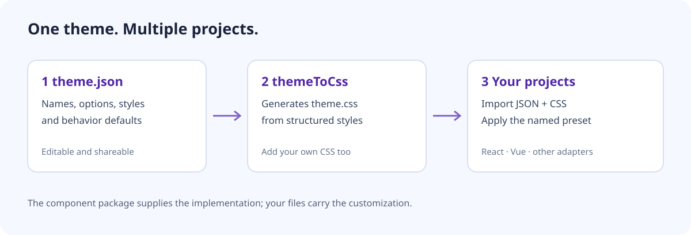
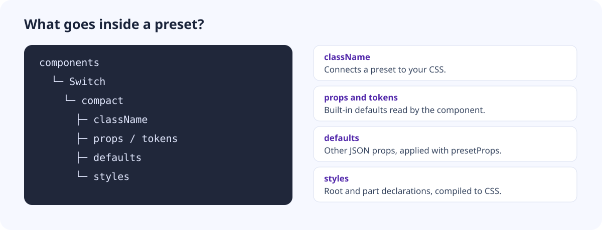

# Themes and presets

Give a Revo UI component a different look and behavior, then use the same design in another project. A **theme** is a JSON file containing named **presets**. A preset belongs to a component, such as `Switch` or `ProgressBar`.



Revo UI remains an ordinary package import. A theme is your project's configuration: it does not install or copy component source code, and it is not a shadcn registry. You can share the JSON and CSS in a repository, an internal package, or by copying the files.

**Jump to:** [Create a preset](#start-with-a-switch) · [Schema fields](#understand-the-schema) · [Behavior defaults](#configure-other-behavior-with-json) · [Vue](#use-the-same-files-in-vue) · [Custom CSS](#write-your-own-css) · [Gallery export](#build-and-share-in-the-gallery) · [Troubleshooting](#troubleshooting)

## Start with a switch

Create `theme.json` in your project. This example names one Switch preset `compact`:

```json
{
  "$schema": "https://ui.rv-grid.com/theme-v1.schema.json",
  "version": 1,
  "components": {
    "Switch": {
      "compact": {
        "className": "my-switch-compact",
        "props": { "labelPosition": "after" },
        "tokens": { "trackWidth": "44px", "trackOn": "#6d28d9" },
        "styles": {
          "root": { "--rv-ui-accent": "#6d28d9" },
          "parts": {
            "thumb": { "box-shadow": "0 0 0 2px white" }
          }
        }
      }
    }
  }
}
```

The `$schema` URL lets compatible editors offer validation and completion. The schema is also included in the installed package as `@revolist/ui/presets/theme.schema.json`. Use a package version that includes the presets API and schema.

### Generate the CSS

Create `generate-theme-css.mjs` beside `theme.json` and run `node generate-theme-css.mjs` from that directory:

```js
import { readFile, writeFile } from 'node:fs/promises';
import { themeToCss } from '@revolist/ui/presets';

const theme = JSON.parse(await readFile('theme.json', 'utf8'));
await writeFile('theme.css', themeToCss(theme));
```

`themeToCss` returns CSS text; it does not inject a stylesheet. Run this step again when structured `styles` change, or use the gallery's CSS download. Add a separate CSS file for selectors that need more flexibility.

### Use it in React

```tsx
import { useState } from 'react';
import { Switch } from '@revolist/ui/react';
import type { UiTheme } from '@revolist/ui/presets';
import rawTheme from './theme.json';
import './theme.css';

const theme = rawTheme as unknown as UiTheme;

export function Notifications() {
  const [enabled, setEnabled] = useState(true);
  return (
    <Switch
      label="Notifications"
      checked={enabled}
      onChange={setEnabled}
      preset={theme.components.Switch?.compact}
    />
  );
}
```

The preset applies its class, built-in `props`, and Switch tokens. Importing `theme.css` applies the compiled `styles`. The application still owns the current value and callback. JSON imports require your project's usual JSON module support.

## Understand the schema



| Field | Purpose | How it takes effect |
| --- | --- | --- |
| `version` | Theme format version; currently `1`. | Required on the theme. |
| `components` | Groups named presets by component name. | Choose a component and preset explicitly. |
| `className` | Connects the component to CSS. | Applied when the component receives the preset. |
| `props` | Built-in preset options supported by that component. | Read automatically by the component. |
| `tokens` | Component-specific design values, where supported. | Read automatically; Switch supports the tokens below. |
| `styles.root` | CSS declarations for the preset class. | Generate and import CSS with `themeToCss`. |
| `styles.parts` | CSS declarations for named `data-part` elements. | Generate and import CSS with `themeToCss`. |
| `defaults` | Other JSON-friendly component props. | Apply with `presetProps` as shown below. |
| `motion` | Event-specific animation timing and keyframes, for components listed below. | Pass the preset; slider motion additionally requires generated CSS. |

Structured part styles stop at an independently nested component marked with `data-part="root"`. Some composed components expose their internal parts to the parent preset: for example, Calendar exposes its day buttons. Give other nested components their own presets, or use ordinary CSS to target deeper descendants.

Not every component has built-in `props` or `tokens`. Check its API reference and the schema for the options it supports. Any component can use a class and structured styles; JSON-friendly props can also be supplied through `defaults`.

A component may have several named presets. Give presets with different styles distinct class names:

```json
{
  "version": 1,
  "components": {
    "Button": {
      "primary": { "className": "brand-button", "props": { "variant": "primary" } },
      "quiet": { "className": "quiet-button", "props": { "variant": "ghost" } }
    }
  }
}
```

## Customize animation

Animation is optional. A motion event can specify `enabled`, `duration`, `delay`, `endDelay`, `easing`, `iterations`, `iterationStart`, `direction`, `fill`, and `keyframes`. Times are in milliseconds. Keyframes use Web Animations properties such as `transform`, `opacity`, and `offset` (a number from 0 to 1). Omitting a setting keeps the component default. Set an event's `enabled` to `false` to turn that effect off.

```json
{
  "version": 1,
  "components": {
    "Switch": {
      "soft": {
        "className": "soft-switch",
        "motion": {
          "settle": {
            "duration": 400,
            "easing": "ease-out",
            "keyframes": [
              { "transform": "scaleX(1)" },
              { "transform": "scaleX(0.8)", "offset": 0.7 },
              { "transform": "scaleX(1)" }
            ]
          }
        }
      }
    },
    "SliderField": {
      "soft": {
        "className": "soft-slider",
        "motion": {
          "hover": {
            "duration": 180,
            "keyframes": [
              { "transform": "scale(1)" },
              { "transform": "scale(1.2)" }
            ]
          },
          "press": { "enabled": false }
        }
      }
    }
  }
}
```

Pass the named preset to the corresponding component as in the example above. Switch, segmented control, calendar, and number stepper read their motion directly from the preset. For slider hover and press, run `themeToCss` and import its output: it contains scoped keyframes and selectors for the native slider thumb. Slider CSS supports `duration`, `delay`, `easing`, `iterations`, `direction`, `fill`, and `keyframes`; `endDelay`, `iterationStart`, and `stagger` apply only to JavaScript-driven events.

| Component | Event names | Available keyframe placeholders |
| --- | --- | --- |
| Switch | `settle` | — |
| SegmentedSwitch, SegmentedControl, Tabs | `selection` | `{{distance}}`, `{{startWidth}}`, `{{endWidth}}` in pixels |
| Calendar and calendar pickers | `selection`, `caption`, `period`, `periodForward`, `periodBackward` | Selection: `{{x}}`, `{{y}}`; period: `{{x}}`, `{{opacity}}`, `{{column}}`, `{{direction}}` |
| NumberStepper | `digits`, `digitsUp`, `digitsDown` | `{{fromY}}`, `{{toY}}`, `{{fromOpacity}}`, `{{toOpacity}}`, `{{direction}}` |
| SingleValueSlider, SliderField, PreactRangeSlider | `hover`, `press` | — |

For example, a segmented selection can end at `translateX({{distance}}px)`. Counter placeholders provide separate start and end values for outgoing and incoming digits. Calendar `periodForward` and `periodBackward` override `period` for their respective directions; number stepper `digitsUp` and `digitsDown` override `digits`. Calendar period and caption transitions are **off by default** and run only when configured. A calendar period can also set `stagger` (milliseconds per column).

The same settings work in the **Animation (JSON)** section of the preset workspace. Enter the event object, choose **Apply animation**, try the preview, and download or save the theme. `validateMotionPreset` checks the shape of untrusted animation data; validate the complete theme against the published schema as well. The slider's simpler `--rv-slider-hover-scale`, `--rv-slider-press-scale`, `--rv-slider-motion-duration`, and `--rv-slider-motion-easing` variables can also be set through `styles.root`.

System reduced-motion preferences and Revo UI's explicit motion-off setting override these animations. Other components can be customized using the preset's class and an ordinary CSS stylesheet, including custom selectors and `@keyframes`; keep that stylesheet alongside the JSON when sharing it. Slider presets require a class name for generated animation CSS.

## Configure other behavior with JSON

Use `defaults` for JSON-friendly component props that are not built-in preset options. Here the progress bar's maximum is shared:

```json
{
  "version": 1,
  "components": {
    "ProgressBar": {
      "capacity": { "className": "capacity-bar", "defaults": { "max": 200 } }
    }
  }
}
```

`defaults` are **not** applied by passing `preset` alone. Use `presetProps` and spread its result before your explicit props:

```tsx
import { ProgressBar } from '@revolist/ui/react';
import { presetProps } from '@revolist/ui/presets';
import type { UiTheme } from '@revolist/ui/presets';
import rawTheme from './theme.json';

const theme = rawTheme as unknown as UiTheme;

<ProgressBar
  {...presetProps(theme.components.ProgressBar?.capacity)}
  value={65}
  ariaLabel="Capacity"
/>
```

This supplies both `max` and `preset`. Put `max={100}` **after** the spread to override the shared value. For built-in `props`, an explicit component prop also wins over the preset. Use the component API reference to find valid prop names and values: the generic `defaults` field does not check them against each component's API.

Defaults must be JSON values. Callbacks, refs, keys, children, and names beginning with `on` belong in application code. For example, keep `onChange` in React state rather than storing a function in JSON.

## Use the same files in Vue

Import the same generated CSS and JSON. This example uses the `ProgressBar` theme above:

```vue
<script setup lang="ts">
import { ProgressBar } from '@revolist/ui/vue';
import { presetProps } from '@revolist/ui/presets';
import theme from './theme.json';
import './theme.css';

const capacityProps = {
  ...presetProps(theme.components.ProgressBar.capacity),
  value: 65,
  ariaLabel: 'Capacity',
};
</script>

<template>
  <ProgressBar v-bind="capacityProps" />
</template>
```

Place explicit properties after the spread when they should override a default. In Angular, Svelte, Preact, or vanilla TypeScript, prepare the props with `presetProps` in application code and pass them through the adapter's normal props interface. Keep framework event handlers in code. See the [framework guides](https://ui.rv-grid.com/frameworks/) for adapter setup.

## Write your own CSS

You can use `className` with a normal stylesheet, without structured `styles` or `themeToCss`:

```css
.my-switch-compact {
  --rv-ui-switch-track-width: 48px;
  --rv-ui-switch-track-on: #2563eb;
}

.my-switch-compact[data-state='checked'] [data-part='thumb'] {
  box-shadow: 0 0 0 2px white;
}
```

Use ordinary CSS for state selectors, responsive rules, pseudo-classes, and other complex styling. Structured `styles` accept CSS property names and simple string values. When `styles` are present, `className` must be a single CSS-safe class name. The generator rejects invalid names and values instead of emitting malformed rules.

The Switch's `tokens` are `trackWidth`, `trackHeight`, `trackPadding`, `thumbSize`, `trackOff`, `trackOn`, and `thumb`. Public CSS variables can override them: `--rv-ui-switch-track-width`, `--rv-ui-switch-track-height`, `--rv-ui-switch-track-padding`, `--rv-ui-switch-thumb-size`, `--rv-ui-switch-track-off-color`, `--rv-ui-switch-track-on`, and `--rv-ui-switch-thumb-color` respectively. Normal CSS cascade and specificity still apply. Switch exposes `label`, `track`, and `thumb` parts and a `checked` or `unchecked` state.

The component API pages list hooks observed in their examples. Parts and states can depend on configuration; open the [Customize workspace](/customize/) and interact with the component preview to see currently visible parts and state attributes. Some popups render separately from their trigger, so inspect them while open. If you provide `AiResultView` with a custom table renderer, that renderer owns its markup and styling.

## Preview a shared theme

Open **Customize** in the gallery header to try an accent color and corner radius across component examples. The color and radius choices stay in this browser as you navigate. The same panel also contains the gallery animation and right-to-left switches. Use the component presets workspace to export JSON and CSS for your projects.

## Build and share in the gallery

1. Open **Customize** in the gallery navigation, then choose **Component presets**.
2. Select the component and name the preset. Compare the default and customized examples.
3. Change available built-in options. Under **JSON styles**, enter a root or part, a CSS property and a value, then choose **Add style**. Use **Additional CSS** for ordinary CSS.
4. For other JSON-friendly props, open **More behavior defaults (JSON)**, enter an object such as `{"max":200}`, and choose **Apply defaults**.
5. Download CSS and JSON, or choose **Save to theme** on several component pages and download the saved theme files together.

Saved presets use browser local storage. Export the files before moving to another browser or project. The CSS download includes Additional CSS; free-form CSS is not encoded in the JSON. Import both files in each project, and use `presetProps` when the preset has `defaults`.

## Troubleshooting

| Symptom | Check |
| --- | --- |
| JSON styles do not appear | Generate and import `theme.css`, and pass the matching named preset to the component. |
| A behavior default is ignored | Apply `presetProps`, check the component's prop name, and look for an explicit prop after the spread. |
| A CSS part is missing | Open the relevant popup or state in the preview; not all parts are mounted all the time. |
| A CSS value is rejected | Use a simple property/value in structured styles, or put complex CSS in a stylesheet. |
| Theme validation fails | Check `version`, component and preset names, supported built-in options, and the schema for your installed version. |

Validate externally sourced theme files before using them. A TypeScript cast such as `as UiTheme` helps with editor types; it does not validate JSON at runtime.


### Ready-made styles

Set `data-rv-style` on a themed container to use a starting look: `compact`,
`sharp`, `soft`, `raised`, or `glass`. Omit the attribute for the standard
style. The style inherits your accent and theme; CSS variables can override its
dimensions and radius. Glass uses translucent surfaces and backdrop blur where
the browser supports it.

```html
<div class="rv-ui" data-rv-style="raised">…</div>
```
